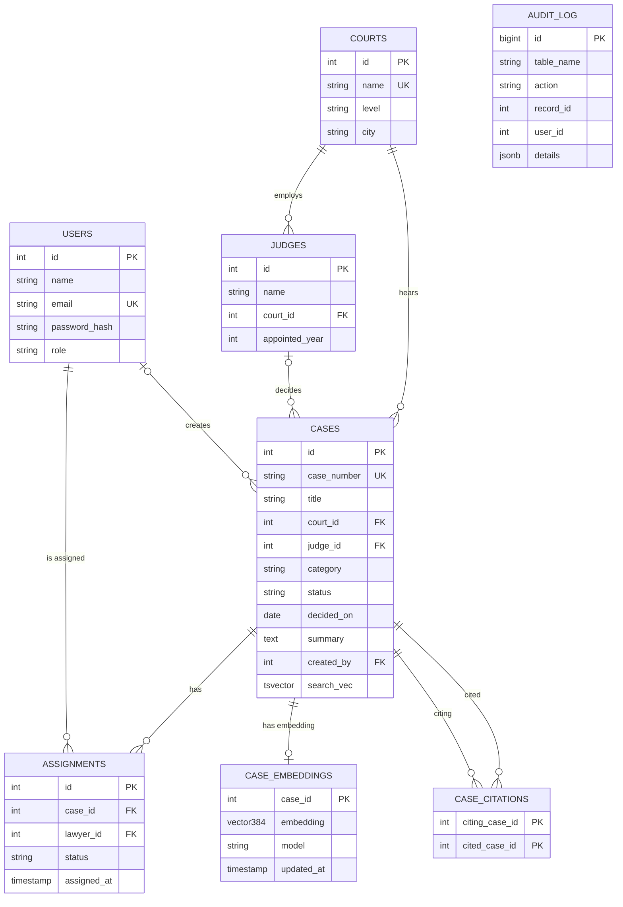

# Legal Case Finder – Project Documentation
*DBMS Experiential Learning Level 3 · PES University · Aug–Dec 2026*
Team: **[Member 1, SRN]**, **[Member 2, SRN]** · Section: **[__]** · GitHub: **[repo URL]**

## 1. Problem statement
Lawyers and clerks research precedent by keyword search, which fails when the same legal idea is phrased differently ("wrongful dismissal" vs "retaliatory termination"). They also lose track of who is handling which case and who changed what. This system supports exact keyword search and **meaning-based search**, tracks citation relationships between judgments, manages case assignments with workload rules, and keeps an audit trail.

## 2. Objectives
1. Store courts, judges, cases, citations and assignments in a normalised relational schema.
2. Find precedent by meaning using vector embeddings and similarity search.
3. Trace which earlier judgments a case relies on (citation chain).
4. Enforce role-based access at both application and database level.
5. Guarantee integrity with constraints, triggers and transactions.

## 3. Scope
In scope: case repository, keyword + semantic search, citation graph, assignment, audit log, dashboard analytics, two roles. Out of scope: PDF upload, e-filing, payments, real court data.

## 4. Functional requirements
| ID | Requirement |
|---|---|
| FR1 | Register (lawyer) / log in; session expires after 8h |
| FR2 | Admin creates, edits, deletes cases (embedding created/refreshed atomically) |
| FR3 | Keyword search with court/category/status filters |
| FR4 | Natural-language search ranked by similarity |
| FR5 | Case page shows citation chain (recursive) and 5 most similar cases |
| FR6 | Admin links citations between cases |
| FR7 | Admin assigns a case to a lawyer (max 5 active per lawyer) |
| FR8 | Lawyer sees only own assignments; marks completed/reopened |
| FR9 | Dashboard: per-court stats and citation analytics |
| FR10 | Admin views audit log of case/assignment changes |

## 5. ER diagram
Render at https://mermaid.live (or GitHub) and export a PNG for submission.

Court 1–N Judge; Court 1–N Case; Judge 1–N Case (optional); Case 1–1 Embedding; **Case M–N Case** (citations); **Case M–N User** (assignments, with own attributes). `audit_log` has no FKs on purpose so history survives deletions.

## 6. Relational schema
```
users(id PK, name, email UNIQUE, password_hash, role CHECK∈{admin,lawyer}, created_at)
courts(id PK, name UNIQUE, level CHECK∈{supreme,high,district}, city)
judges(id PK, name, court_id FK→courts, appointed_year, UNIQUE(name,court_id))
cases(id PK, case_number UNIQUE, title, court_id FK→courts, judge_id FK→judges NULL, category CHECK, status CHECK,
      decided_on CHECK ≤ today, summary CHECK len≥30, created_by FK→users, created_at, updated_at, search_vec GENERATED)
case_embeddings(case_id PK/FK→cases ON DELETE CASCADE, embedding vector(384), model, updated_at)
case_citations(citing_case_id FK, cited_case_id FK, PK(citing,cited), CHECK citing≠cited)
assignments(id PK, case_id FK, lawyer_id FK, status CHECK, assigned_at, UNIQUE(case_id,lawyer_id))
audit_log(id PK, table_name, action, record_id, user_id, changed_at, details JSONB)
```
All tables are in 3NF/BCNF: court data lives in `courts`, judge data in `judges`, M:N links in their own tables, no transitive dependencies.

## 7. Database choice and justification
| Data | Technology | Why |
|---|---|---|
| Users, courts, judges, cases, citations, assignments, audit | **PostgreSQL** | Strongly relational; needs ACID, constraints, triggers, joins, recursive queries, RLS |
| Case meaning | **pgvector** | Semantic similarity needs embeddings + ANN index. Same DB as the case row ⇒ one transaction updates text and vector together, and similarity combines with SQL filters/joins |
| Keyword search | **PostgreSQL full-text (tsvector + GIN)** | Stemming + ranking without a separate search engine |

A separate MongoDB/Qdrant server was considered and rejected: duplicated data, cross-system consistency risk, and no capability this dataset needs.

## 8. Data dictionary
Columns: see section 6. Key constraints: `case_number` unique business key; `summary ≥ 30 chars` guarantees embeddable text; `email` regex-validated; `assignments` unique per (case, lawyer); `case_citations` forbids self-citation; `decided_on` cannot be in the future.

## 9. Vector database design
| Item | Design |
|---|---|
| Embedded data | `title + ". " + summary` |
| Model | `all-MiniLM-L6-v2` run locally (transformers.js) |
| Dimensions | 384, L2-normalised |
| Storage | `case_embeddings.embedding vector(384)`, 1 row/case, `model` column for provenance |
| Index | HNSW, `vector_cosine_ops` |
| Metric | Cosine distance `<=>`; similarity shown = 1 − distance |
| Retrieval | Embed query with same model → `ORDER BY embedding <=> q LIMIT 10`, optional category filter |
| Vector CRUD | Create on case insert · Read via similarity search · Update: edit re-embeds (`ON CONFLICT DO UPDATE`) · Delete: `ON DELETE CASCADE` |

## 10. Advanced database features
View `v_court_stats` · Function `fn_citation_count` · Procedure `assign_case` · Triggers `touch_cases`, `audit_cases`, `audit_assignments`, `validate_assignment` · Transactions (case + embedding; every request) · Recursive CTE (citation chain) · Full-text search (GIN) · Vector similarity (HNSW) · Indexes · RBAC roles + column GRANTs + Row Level Security.

## 11. Important queries
Correlated subquery (cases cited above their court's average) and GROUP BY/HAVING in `/api/stats`; joins, recursive CTE and vector neighbours in `/api/cases/[id]`; vector search in `/api/search/semantic`; full-text + `ts_rank` in `/api/cases`; INSERT/UPDATE/DELETE across cases, assignments, citations.

## 12. System architecture
```
Browser (Next.js/React) → fetch /api/* (httpOnly JWT cookie)
→ Next.js middleware (auth gate) → Route Handlers (role guard, error mapping)
→ pg pool: BEGIN; SET LOCAL ROLE legal_*; set app.user_id; …; COMMIT
→ PostgreSQL 16 + pgvector      (embedding model runs inside the Node server)
```

## 13. Application screenshots
*(Insert: login, dashboard, keyword search, semantic search, case detail, admin add-case, assignments, audit log)*

## 14. Testing results
| # | Test | Expected | Result |
|---|---|---|---|
| T1 | Request without login | 401 | Pass |
| T2 | Wrong password | 401 | Pass |
| T3 | Lawyer POST /api/cases | 403 | Pass |
| T4 | Lawyer GET /api/audit | 403 | Pass |
| T5 | Lawyer lists assignments | Only own rows (RLS) | Pass |
| T6 | Lawyer updates another lawyer's assignment | 0 rows affected | Pass |
| T7 | Lawyer `DELETE FROM cases` in SQL | permission denied | Pass |
| T8 | Lawyer `SELECT password_hash FROM users` | permission denied | Pass |
| T9 | 6th active assignment for a lawyer | trigger error | Pass |
| T10 | Assign case to an admin user | "is not a lawyer" | Pass |
| T11 | Citation cycle 1→2→3→1 in recursive CTE | terminates | Pass |
| T12 | Vector query plan | uses HNSW index | Pass |
| T13 | Duplicate case_number / bad status / future date | rejected by constraints | *(run in demo)* |
| T14 | Query "boss fired me for complaining" | employment case ranks high | *(run after seeding)* |

## 15. Conclusion and future enhancements
Relational integrity, full-text search and vector similarity coexist in one PostgreSQL database. Future: PDF ingestion with chunk-level embeddings, hybrid ranking (full-text + vector), Neo4j citation graph, rate limiting, pagination, automated tests.

## 16. Individual contributions
| Member | Responsibility |
|---|---|
| **[Member 1]** | ER design, DDL, triggers/procedure/view, RBAC & RLS, SQL queries, DB testing |
| **[Member 2]** | Next.js UI, route handlers, auth/session, embeddings + semantic search, seed data, README |
Both must have commits in both layers (the rubric requires it) — check the Git history shows that.
